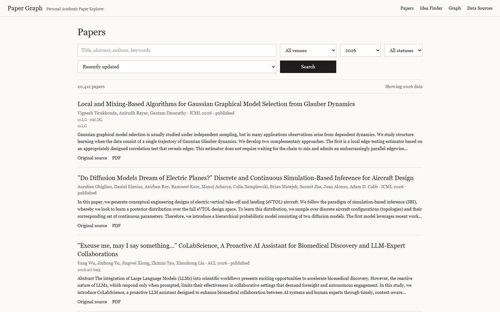
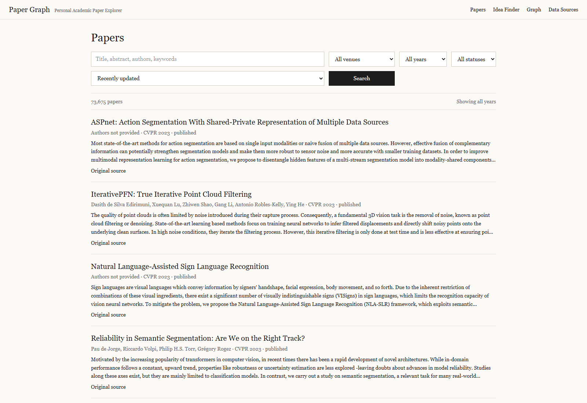
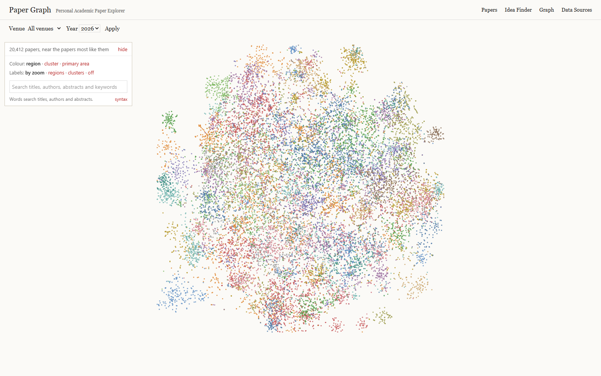
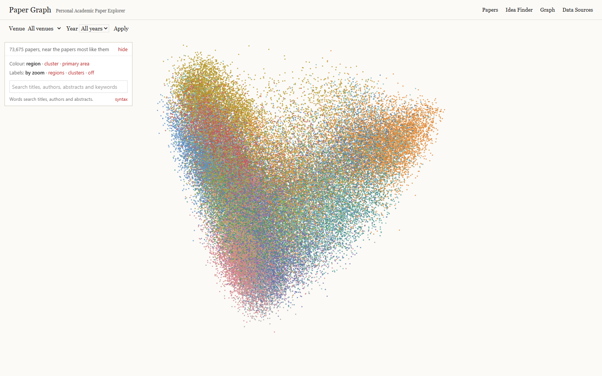
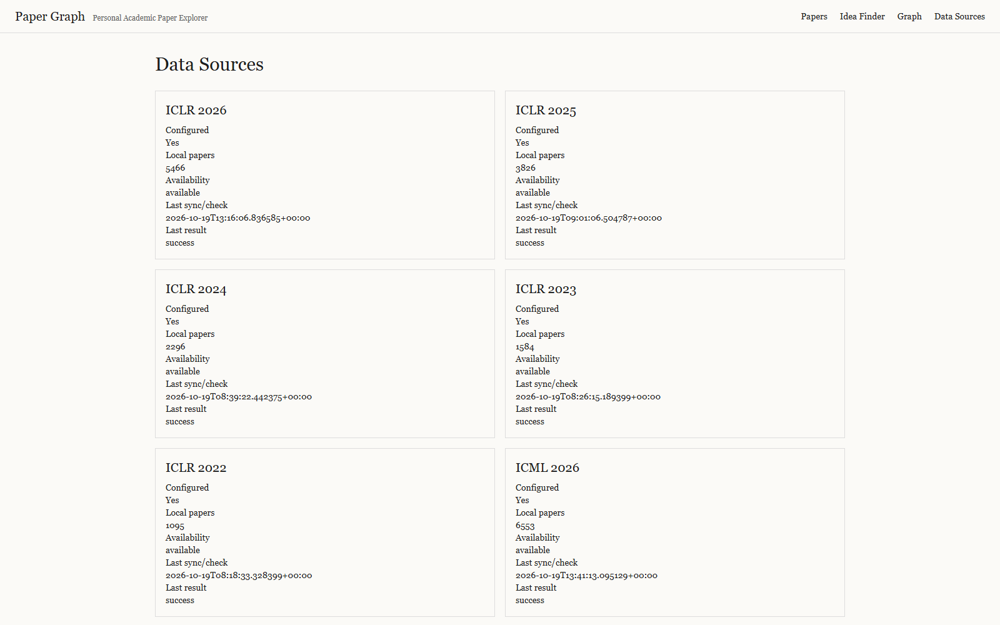
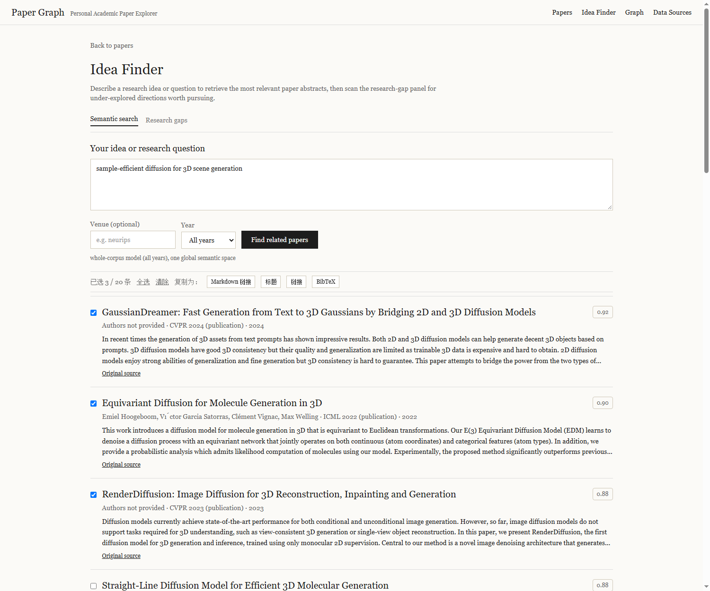

# Paper Graph

Paper Graph is a local, login-free academic paper browser. It stores source metadata in `Data/database/papers.sqlite`, serves it through the FastAPI service in `research-self`, and keeps the AcceptOdds Paper Map renderer, minimap and layout worker in the Next.js app (`acceptodds`). The prediction-market product has been removed.

## Screenshots

Papers page — the UI opens on the newest year that actually has data, and the Year control offers **All years** to browse the whole corpus at once. The repaired 2022–2026 corpus holds **73,675 papers** (5 conferences + TMLR journal):





Paper map — one semantic coordinate per paper (TF-IDF/SVD + t-SNE neighbourhood projection + KMeans), rebuilt for every venue-year:



Paper map with **All years**: the whole corpus in one globally fitted semantic space (PCA-2 over a single TF-IDF/SVD model fitted on all 73,675 papers — per-venue-year layouts live in separate SVD bases and cannot be overlaid):



Data Sources — per-venue, per-year local paper counts and last sync status:



Paper detail — abstract, extracted research questions, stated gaps and related papers:


Idea Finder — type an idea, get the most relevant papers across the whole corpus, tick the ones you want and copy them as Markdown links, titles, URLs or BibTeX:



The same search in Chinese. Chinese academic terms are bridged to their English surface forms on the query side (`扩散模型` → `diffusion model`, `三维场景` → `3d scene`), so a Chinese question reaches the English corpus; the fitted model and stored vectors are untouched:


Research gaps — under-combined topic pairs, under-explored areas and explicitly stated gaps, per year:


## All-years mode and the idea finder

**All years.** Every year control (`/` and `/map`) accepts `year=all`: the list pages through the whole corpus, and the map plots it in one space. Per-venue-year maps keep their own layout, which is correct for comparing papers *within* a year. Use `python -m paper_ingest.global_layout` to (re)build the global model after a corpus change; it writes `Data/graph/all_all_semantic.pkl`, `Data/graph/all_all_vectors.npz` and the `graph_points_global` table (~3 min for 73k papers).

**Idea finder** (`/ideas`) ranks the corpus against a free-text idea, in English or Chinese. With *All years* it scores every paper in the global space (one matrix–vector product over the cached float32 matrix), otherwise it uses that year's fitted model. Each hit is selectable, and the sticky toolbar copies the selection — or every result when nothing is ticked — as **Markdown links**, **titles**, **plain URLs** or **BibTeX**. Link preference is the publisher landing page, then `https://doi.org/<doi>`, then this app's `/papers/<slug>` page.

A first search in a given scope takes ~20 s because it builds that scope's vector matrix; later searches in the same scope are ~2 s from cache. The gaps tab only scans when you open it (20–30 s for a full year, then cached), and it is disabled for the all-years scope, where a quadratic comparison is not meaningful.

Three honest outcomes are reported separately rather than collapsing into one scary error:

| Situation | `method` | What the UI says |
|---|---|---|
| Normal semantic ranking | `semantic-svd` / `semantic-svd-global` | the results, with scores |
| Query shares no term with the vocabulary (typo, only stopwords) | `keyword-fallback` | "没有匹配到这个语义模型能理解的研究术语…请换用英文研究术语再试" and word-matched hits if any |
| The global index was never built | `keyword-fallback` | "whole-corpus semantic index unavailable" — run `python -m paper_ingest.global_layout` |

## Hybrid retrieval (why "SECI" works now)

The Idea Finder used to rank with a single TF-IDF/SVD channel, which fails
predictably: an acronym like **SECI** is not in the 1024-word SVD vocabulary, so
the query vector was zero and the search collapsed to a keyword fallback with one
0.00-scored row. Search is now three channels fused by **Reciprocal Rank
Fusion** (rank-based, so cosine and BM25 need no score calibration):

1. **Semantic** — cosine in the fitted vector space (the main channel);
2. **FTS lexical** — whole tokens *and* prefix tokens (`learn*` matches
   "learning"; bm25-ranked; the OR has to be explicit, `"learn" learn*` would be
   an implicit AND and match nothing);
3. **Substring** — LIKE over titles and abstracts, the channel that finds
   "Secilia-Cxy" and "baseCIL" for `SECI`.

A query the vocabulary cannot see still answers through channels 2–3, and the
API adds two kinds of one-click refinements: **相近术语** (vocabulary terms close
to the query spelling — `SECI` suggests `semi`, `social`, `series`…) and **相关词**
(frequent words from the top hits, pseudo-relevance feedback). Clicking a chip
re-runs the search with it.

Measured on `SECI` (all years): 3 hits (the one real SECI paper, plus the two
papers whose GitHub links contain the substring) plus 6 spelling suggestions —
previously a single 0.00-scored row. Normal queries keep their semantic ranking;
Chinese queries keep the term bridge.


## Map performance notes

The map is usable at corpus scale because of four changes:

- `/api/graph` no longer ships the 48-dim vectors or the title map (they were unused by the map); `?include=full` still returns them. The ICML 2026 payload went from **6.4 MB to 288 KB**.
- Responses are gzip-compressed (≈5–6×), and payloads are cached in-process for 10 minutes.
- Titles are fetched lazily, debounced, only for the slugs about to be labelled (`/api/graph/titles?...&slugs=a,b,c`).
- Above 25,000 points the map skips collision-tested topic labels and the worker re-layout during a search, both of which are per-frame costs that grow with the corpus.

Two slow endpoints (`/api/papers/semantic`, `/api/gaps`) are Next.js route handlers rather than `next.config` rewrites: the rewrite proxy closes the connection with `socket hang up` past ~30 s, while a cold semantic search or a gap scan legitimately takes 20–40 s.

## Data coverage (2022–2026)

Every venue-year was rebuilt from the publishers' own indexes (ICLR virtual site, PMLR, NeurIPS Proceedings, ACL Anthology, CVF Open Access, jmlr.org for TMLR) and then deduplicated across sources. Journal papers come from OpenAlex (see the journal section below). Conference counts grow strictly year over year:

| Year | Conference papers | Journal papers | Total | Conference abstract coverage |
|---:|---:|---:|---:|---:|
| 2022 | 8,294 | 21,374 | 29,668 | 97% |
| 2023 | 11,291 | 22,807 | 34,098 | 94% |
| 2024 | 14,227 | 26,128 | 40,355 | 93% |
| 2025 | 19,451 | 27,899 | 47,350 | 92% |
| 2026 | 20,412 | 24,728 | 45,140 | 91% |
| **Total** | **73,675** | **122,936** | **196,611** | **93%** |

Known gaps: NeurIPS 2026 proceedings are not published yet (December 2026); TMLR abstracts are behind an OpenReview Cloudflare challenge (metadata is complete); 122 measured title-variant cross-source twins are retained rather than deleted. Root causes, fixes, per-cell expected-vs-actual numbers, and the rollback files are documented in [DATA_COVERAGE_REPAIR_REPORT.md](DATA_COVERAGE_REPAIR_REPORT.md).

## Journal papers (Springer Nature, Science/Cell, IEEE, JMLR, …)

The corpus was conference-only, which biased retrieval toward CS conference
literature. It now also carries high-impact **journals** with the same metadata
scope as everything else (title + abstract + authors + DOI + year; no PDFs).
**122,936 journal papers across 15 titles × 2022–2026; 196,611 papers total.**

- **Source**: OpenAlex journal source ids (`paper_ingest/provider_journals.py`),
  15 curated titles across Springer Nature (Nature, Nature MI, Nature
  Communications, Nature Methods/Neuroscience, npj QI), AAAS/Cell Press
  (Science, Cell, Neuron), IEEE (TPAMI, IJCV), JMLR, APS (PRL) and
  chemistry/medicine (JACS, The Lancet). `type:article` only — editorials and
  corrections are excluded by design. **JMLR is the exception**: OpenAlex
  attaches almost no recent works to its source (per-year count 0 for
  2022–2024/2026), so it comes from the publisher's own site instead
  (`paper_ingest/jmlr.py`, the same jmlr.org that serves TMLR) — 1,486 papers
  with 100% abstract coverage.
- **Abstract recovery** (measured, per journal):

  | Journal | Papers | Abstract coverage |
  |---|---:|---:|
  | Nature Communications | 45,655 | 99% |
  | JACS | 17,956 | 99% |
  | Nature | 17,568 | 28%¹ |
  | Physical Review Letters | 12,271 | 97% |
  | Science | 8,392 | 56%¹ |
  | The Lancet | 6,755 | 5%² |
  | IEEE TPAMI | 3,747 | 98% |
  | Cell | 2,389 | 86%³ |
  | JMLR | 1,486 | 100% |
  | IJCV | 1,430 | 100% |
  | Nature MI / Methods / Neuron / npj QI | 5,287 | 26–99%¹ |
  | **All journals** | **122,936** | **78%** |

  Two channels, tried in order (`paper_ingest/journal_abstracts.py`):
  1. **Europe PMC** (EBI's public API, no key) — carries the research articles
     with their *full* abstract. Measured 39/40 hits on the real pending set at
     2.2 lookups/second, stable at 10 concurrent requests. This is what took
     Cell from 43% to 86% and IJCV to 100%.
  2. **The publisher's landing page** — the article's abstract block
     (`<div id="Abs1-content">`, 1,666 chars) or `og:description` (a 243-char
     teaser). Needed for what Europe PMC does not index.

  ¹ The remaining gap is the data, not the collector: Nature's *news* DOIs
     (`10.1038/d41586-*`) are not research articles, Europe PMC does not carry
     them, and the publisher serves them a challenge page. The pass detects
     that and stops rather than burning an hour for nothing.
  ² The Lancet's abstracts are withheld by the publisher (PubMed and Europe
     PMC both show none for them) — a copyright policy, not a bug.
  ³ Elsevier's site is behind a bot wall (doi.org serves a meta-refresh
     interstitial, direct URLs 403), so Elsevier rows rely on Europe PMC.
- **Harvest**: `python _run_journals.py [journal] [year] [--limit N]
  [--no-backfill]` (idempotent). Measured OpenAlex limits, all handled:
  - **Cursor paging is gated** (HTTP 401 without a key) — the provider pages by
    offset instead.
  - **Offset paging stops at 50 pages / 10,000 works** (page 50 → 200, page 51
    → HTTP 400). Years above that (Nature Communications 2024–2026) import as
    their first 10,000 articles; the year is still recorded.
  - **Per-IP daily budget** — HTTP 401 when exhausted; rerun the next day or
    set a free `OPENALEX_API_KEY`.

## Semantics upgrade (2026-10)

The semantic space is finer: TF-IDF vocabulary 1024 → **20,000 features** with
1–3-grams, and the SVD width 48 → **128 dims** (global model; per-cell graphs
follow suit). That is what lets rare-but-precise terms survive the projection —
the old 1024-feature space was why "SECI" produced a zero query vector — while
search stays a sub-second matrix–vector product (float32 197k×128).

`python -m paper_ingest.global_layout` rebuilds the global model (~20 min at
197k papers); it must be re-run after any corpus change so the all-years space
covers the new papers.

## Performance at 197k papers

Growing the corpus 2.7× exposed a query plan that had been fine at 73k:
`/api/papers` filtered venues with a correlated `EXISTS (SELECT 1 FROM
paper_venues …)` per paper row, so SQLite scanned all 195k papers and probed
`paper_venues` for each — **236 s for one page**. The filter now *drives* from
`paper_venues` (its `(venue_id, year)` index covers the selective case, with a
new `paper_venues(year)` index for year-only queries):

| Query | Before | After |
|---|---:|---:|
| venue + year | 236 s | **0.03 s** |
| venue, all years | — | 0.09 s |
| year only | — | 0.32 s |
| no filter | — | 0.94 s |

`tests/test_list_papers_query.py` pins both the SQL shape (the correlated form
is banned outright) and the results (no duplicates, stable totals, <5 s on a
20k-row corpus).

## Collector hardening (2026-10)

The harvesting layer was reviewed along six axes — resilience, source coverage,
data quality, observability, scale, testability — and the gaps that mattered
were closed:

- **`paper_ingest/crawl.py` — one policy for every collector.** Four modules
  had each grown their own answer to "is this failure retryable?", "how long
  do we wait?" and "when do we give up?", and the differences were where the
  bugs lived. The shared base states them once: `TransientError` /
  `PermanentError` / `BlockedError`, a token-bucket `RateLimiter`, a
  `RetryPolicy` (exponential backoff with jitter, `Retry-After` honoured but
  clamped so a broken header cannot stall a sync), a proportional
  `CircuitBreaker`, and a `CrawlRecorder` for run statistics. It is now the
  actual implementation behind `PoliteHttp`'s backoff and the journal
  backfill's breaker, not a parallel copy.
- **`paper_ingest/manifest.py` — a silent empty harvest is now impossible.**
  The recurring failure was a provider quietly returning less (or nothing)
  while the sync reported success. Each venue-year has an expected size
  (`Data/expected_counts.yaml`, generated from the measured corpus with min at
  ~90% and max at ~110%); a harvest that lands short is reported as `short`
  on the venue status and on its sync job — never an exception, never silent.
  `/api/venues` reports `expected_count` and `coverage_status` per venue-year
  (84 checked, 84 ok at the time of writing).
- **`paper_ingest/normalize.py` — one spelling per field.** The sources
  disagree on shape: `"Joshua R. Wang"` vs `"Wang, Joshua R."` vs `"J. Wang"`,
  `https://doi.org/10.x/y` vs `doi:10.x/y` vs `10.x/y`, and scraped titles
  carry LaTeX (`$O(n \log n)$`, `\emph{...}`). Normalised display forms and
  comparison keys live here, so an author search finds a person under every
  spelling and the index is not polluted with markup. LaTeX *formatting*
  commands are dropped while *symbolic* ones (`\log`) are kept.
- **`paper_ingest/replay.py` — the collectors can be tested offline.**
  Recorded HTTP responses replayed through the real parsing code: a publisher
  changing its markup or an API changing a field now fails a test instead of
  silently emptying a harvest. `tests/fixtures/` holds structurally faithful
  payloads for OpenAlex, jmlr.org, Europe PMC and arXiv.
- **A DBLP source was evaluated and rejected**: it answers `202` (accepted,
  result not ready) for minutes at a time and then `429` — even at two seconds
  apart — so it is not usable as a supplementary source. OpenAlex already
  indexes the same venues.

**Operational note**: OpenAlex meters requests per IP against a small shared
daily budget when no API key is supplied; a harvest burst exhausts it and the
API then answers `401`. Set `OPENALEX_API_KEY` (free) for a stable budget, and
`PAPER_CONTACT_EMAIL` for the polite pool.

### Running the collector

Every harvesting path has one command. `python -m paper_ingest --help` lists
them; each prints one JSON document and exits non-zero on failure.

```powershell
cd research-self

# What the corpus holds, and whether each venue-year is complete.
python -m paper_ingest coverage

# Harvest journals, then fill their abstracts, then audit the result.
python -m paper_ingest harvest --venue all --from-year 2022 --to-year 2026

# Re-run one journal-year from its stored watermark (one request, not fifty).
python -m paper_ingest journals --venue nature --year 2025 --incremental

# Only the works OpenAlex indexed after a date.
python -m paper_ingest journals --venue science --year 2025 --since 2026-01-01

# The other collectors.
python -m paper_ingest sync-api --venue icml --year 2025
python -m paper_ingest journal-abstracts --venue cell --year 2024
python -m paper_ingest jmlr --year 2024
```

The watermark is stored per venue-year and only advances after a *successful*
harvest — a failed run must not claim to have caught up. A record that has not
changed is counted and left alone, so re-running a settled year rewrites
nothing.

The expected-size manifest lives in `Data/expected_counts.yaml`; the same
block, with the numbers documented, is in `research-self/venues.example.yaml`.

## Start on Windows

Requirements: Python 3.11+, Node.js 20.9+ and PowerShell.

```powershell
cd F:\AIWork\paper_graph
.\start-paper-graph.ps1 -InstallDependencies
# later starts: .\start-paper-graph.ps1
```

The script checks dependencies, refuses occupied ports, writes logs to `Data/logs`, waits for `/api/health` and opens services at <http://127.0.0.1:3000> and <http://127.0.0.1:8000/docs>. Use `-Production` after `npm run build`; stop with the printed `Stop-Process` command.

Manual development:

```powershell
cd F:\AIWork\paper_graph\research-self
.\.venv\Scripts\Activate.ps1
pip install -e ".[test]"
python -m uvicorn paper_ingest.api:app --host 127.0.0.1 --port 8000
# second terminal
cd F:\AIWork\paper_graph\acceptodds
npm ci
npm run dev
```

Pages: Papers `/`, Graph `/map`, Data Sources `/sources`, and paper details `/papers/{id}`. The six configured venues remain ICLR, NeurIPS, ICML, ACL/ARR, CVPR and TMLR, and the UI opens on the newest year that actually has data (2026 at the time of writing). Collection commands remain documented in `research-self/README.md`; this phase does not change source access.

## Verification

```powershell
cd F:\AIWork\paper_graph\acceptodds
npm test; npm run typecheck; npm run lint -- src tests; npm run build
cd ..\research-self
.\.venv\Scripts\python.exe -m pytest -q
.\.venv\Scripts\python.exe tests\audit_check.py
.\.venv\Scripts\python.exe tests\browser_check.py
```

See [DATA_COVERAGE_REPAIR_REPORT.md](DATA_COVERAGE_REPAIR_REPORT.md), [MARKET_REMOVAL_AUDIT.md](MARKET_REMOVAL_AUDIT.md), [IMPLEMENTATION_REPORT.md](IMPLEMENTATION_REPORT.md), [TEST_REPORT.md](TEST_REPORT.md) and [PROJECT_AUDIT.md](PROJECT_AUDIT.md). The upstream repository has no clear license; keep this checkout for personal local research.

## Origin And Scope

Paper Graph is derived from the open-source [AcceptOdds](https://github.com/benedict-armstrong/acceptodds) codebase. AcceptOdds supplied the initial Next.js paper-map experience and reusable graph components such as `MapCanvas`, `Minimap`, graph interaction, local layout, UMAP/d3-force integration, and paper navigation. The upstream checkout did not provide a clear license statement, so this project is intended for local personal research and validation; review licensing before redistribution.

The application has been converted into a paper browser and graph explorer. Removed or replaced areas include prediction markets, Accept/Reject trading, LMSR pricing, odds, positions, portfolios, wallets, settlement, leaderboards, accounts, authentication, email verification, trading API keys, market administration, trading notifications, and market-only database/API modules. Paper list, detail, search, related-paper, review, venue-status, and graph capabilities were retained and connected to the local Python/FastAPI research database. This cleanup is ongoing and future releases may remove more legacy compatibility code. See `MARKET_REMOVAL_AUDIT.md` and `PROJECT_AUDIT.md`.

## Open-Access Collection Policy

The collector is a metadata crawler for publicly accessible scholarly sources. It focuses on title, authors, abstract, venue, year, DOI and public source/PDF links from official proceedings, ACL Anthology, PMLR, CVF Open Access, NeurIPS Proceedings, and public OpenReview records when the API permits access. It does not bypass authentication, anti-bot challenges, paywalls, private reviews, or access controls, and does not download paywalled papers. A missing future proceedings page is recorded as `not_open`; a public source blocked by an access challenge is recorded as `restricted`.

## Repository Hygiene

The public repository excludes `Data/`, SQLite databases, raw snapshots, graph caches, `.env` files, local venue configuration, virtual environments, `node_modules`, `.next`, logs and the locally built Windows EXE. These files can contain large datasets, machine-specific paths, or local configuration. Use the example files and run the collector locally to recreate them.

## Double-click EXE viewer

The repository root contains `PaperGraph.exe`. Double-click it, or run `.\PaperGraph.exe` from PowerShell. It starts the existing local FastAPI and production Next.js services, checks both health endpoints, opens the ICML 2025 Paper Map, and shows buttons for Papers and Data Sources. The map uses the existing Graph renderer and the generated per-venue coordinates; current corpus counts are in [DATA_COVERAGE_REPAIR_REPORT.md](DATA_COVERAGE_REPAIR_REPORT.md). Close the launcher window to stop only the processes it started. If the EXE is rebuilt, run `.\launcher\build-launcher.ps1` after `npm run build`.

The launcher expects this repository layout, the Python virtual environment at `research-self\.venv`, frontend `node_modules`, `.next\BUILD_ID`, and `Data\database\papers.sqlite`. It never downloads data or changes the Graph algorithm. Startup logs are written to `Data\logs\launcher.log`.

## Real data import commands

```powershell
cd F:\AIWork\paper_graph\research-self
.\.venv\Scripts\python.exe -m paper_ingest sync --venue icml --year 2025
.\.venv\Scripts\python.exe -m paper_ingest sync --venue acl --year 2025 --limit 10
.\.venv\Scripts\python.exe -m paper_ingest sync --venue cvpr --year 2026 --limit 5
.\.venv\Scripts\python.exe -m paper_ingest sync --venue neurips --year 2025 --limit 10
.\.venv\Scripts\python.exe -m paper_ingest status
```

Browse <http://127.0.0.1:3000/?venue=icml&year=2025> or change the Year control to 2024/2025/2026. The default is the newest year with data (2026 at the time of writing). Latest actual counts and limitations are in [DATA_COVERAGE_REPAIR_REPORT.md](DATA_COVERAGE_REPAIR_REPORT.md), `DATA_INGESTION_REPORT.md` and `DATA_SOURCE_STATUS.md`. Official SDK diagnostics are optional: `pip install -e ".[openreview-sdk]"`, then `python tests/sdk_openreview_probe.py`. No PDF files are downloaded.
