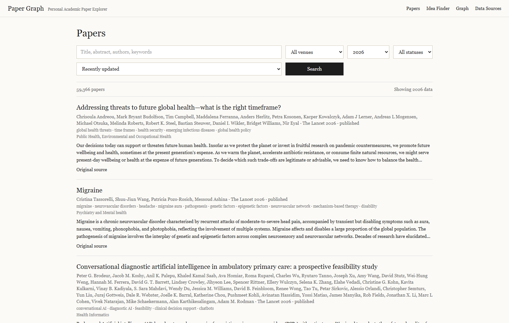
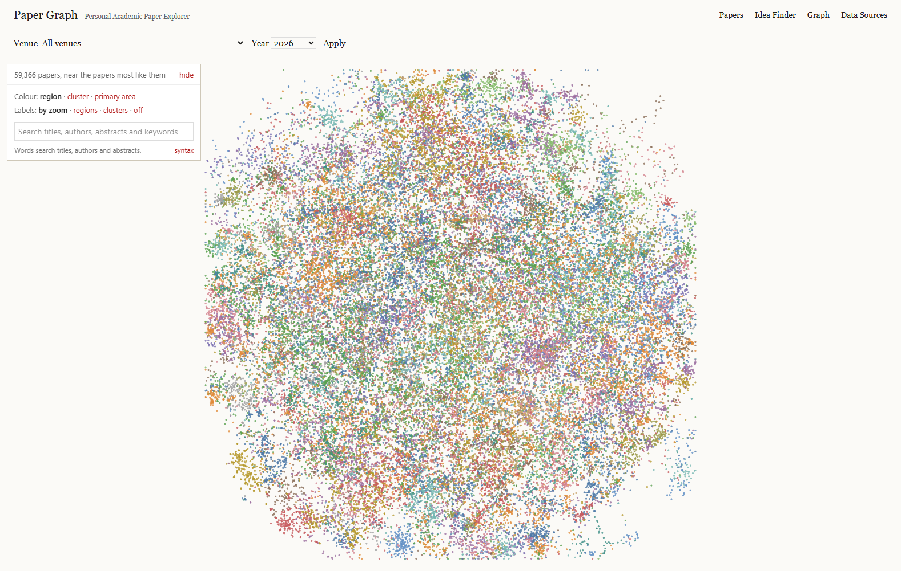
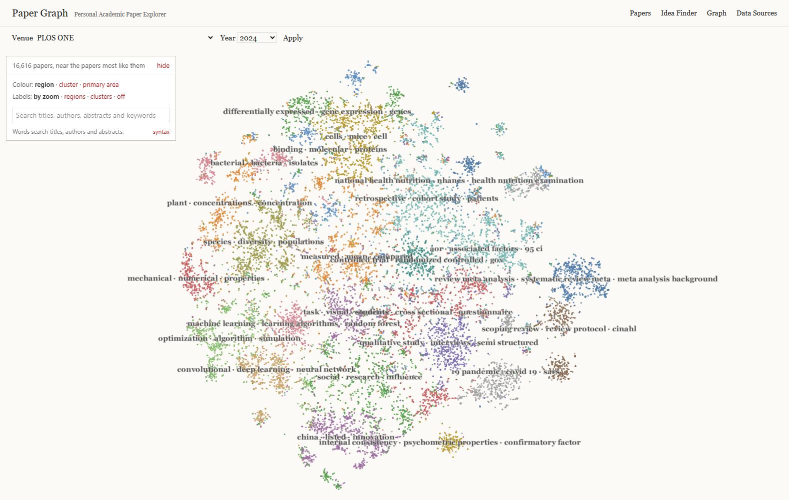
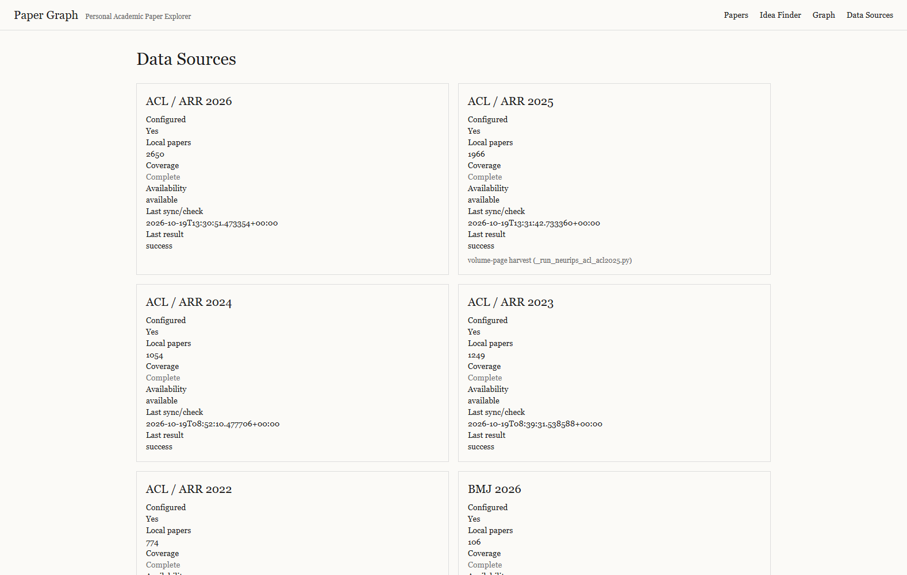
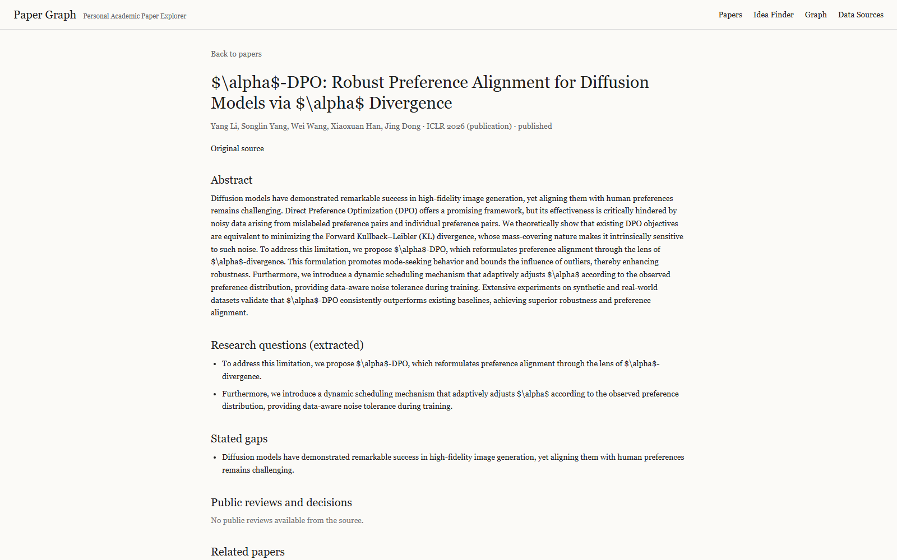
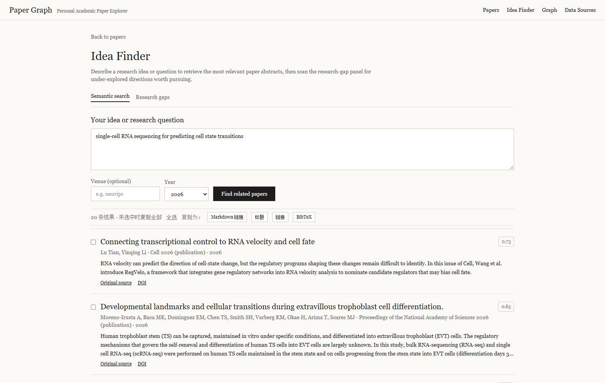
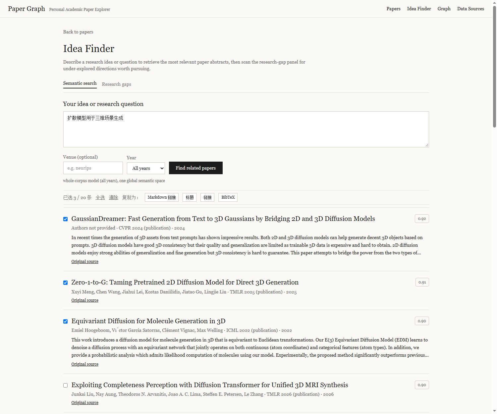
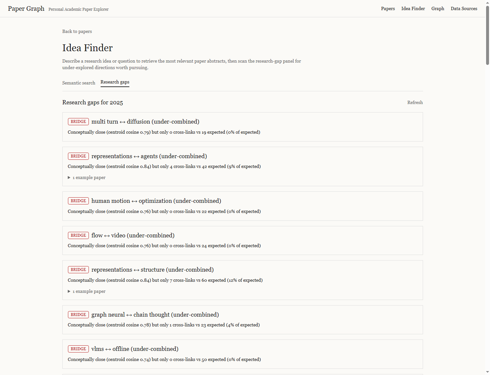
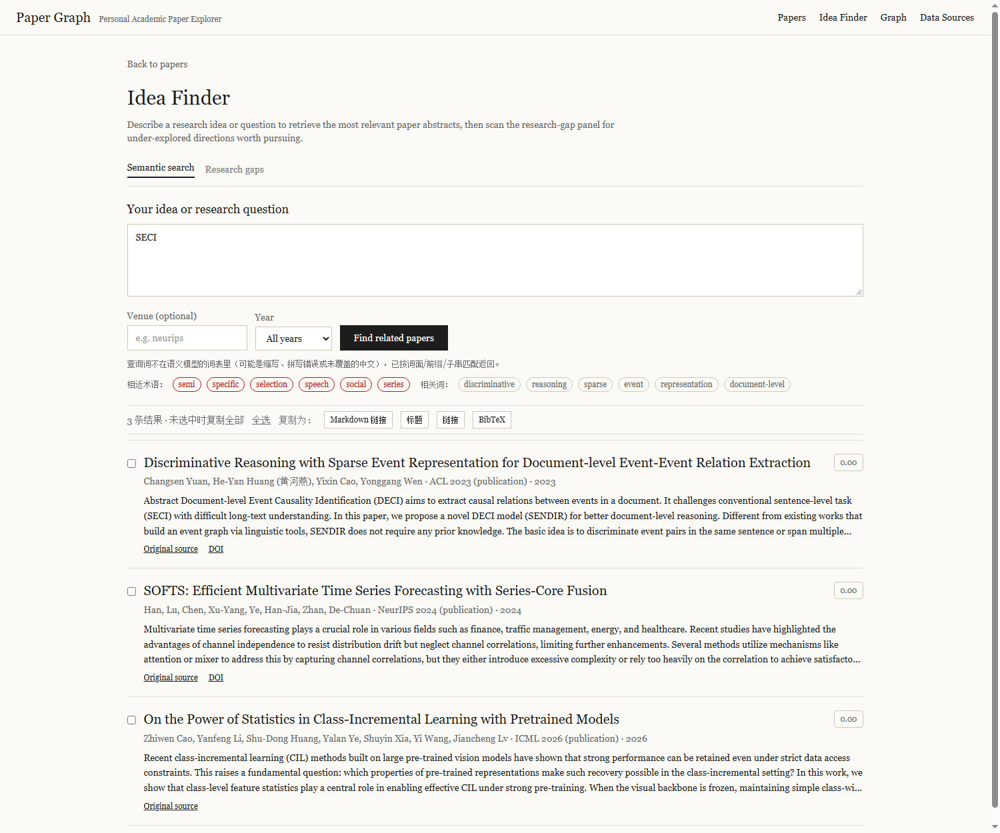

# Paper Graph

Paper Graph is a local, login-free academic paper browser. It stores source metadata in `Data/database/papers.sqlite`, serves it through the FastAPI service in `research-self`, and keeps the AcceptOdds Paper Map renderer, minimap and layout worker in the Next.js app (`acceptodds`). The prediction-market product has been removed.

## Screenshots

Papers page — the UI opens on the newest year that actually has data, and the Year control offers **All years** to browse the whole corpus at once. The 2022–2026 corpus holds **288,262 papers** (5 conferences + 25 journals):



Paper map — one semantic coordinate per paper (TF-IDF/SVD + t-SNE neighbourhood projection + KMeans), rebuilt for every venue-year:



A single journal year, which used to render an **empty canvas** until each venue-year got its own layout:



Data Sources — per-venue, per-year local paper counts, last sync status and the coverage verdict:



Paper detail — abstract, extracted research questions, stated gaps and related papers:



Idea Finder — type an idea, get the most relevant papers across the whole corpus, tick the ones you want and copy them as Markdown links, titles, URLs or BibTeX. Here the idea is *single-cell RNA sequencing for predicting cell state transitions*, and the top two hits come from **Cell 2026** and **PNAS 2026** — journals the Europe PMC collector added:



The same search in Chinese. Chinese academic terms are bridged to their English surface forms on the query side (`扩散模型` → `diffusion model`, `三维场景` → `3d scene`), so a Chinese question reaches the English corpus; the fitted model and stored vectors are untouched:



Research gaps — under-combined topic pairs, under-explored areas and explicitly stated gaps, per year:



## All-years mode and the idea finder

**All years.** Every year control (`/` and `/map`) accepts `year=all`: the list pages through the whole corpus, and the map plots it in one space. Per-venue-year maps keep their own layout, which is correct for comparing papers *within* a year. Use `python -m paper_ingest.global_layout` to (re)build the global model after a corpus change; it writes `Data/graph/all_all_semantic.pkl`, `Data/graph/all_all_vectors.npz` and the `graph_points_global` table (~3 min for 73k papers).

**Idea finder** (`/ideas`) ranks the corpus against a free-text idea, in English or Chinese. With *All years* it scores every paper in the global space (one matrix–vector product over the cached float32 matrix), otherwise it uses that year's fitted model. Each hit is selectable, and the sticky toolbar copies the selection — or every result when nothing is ticked — as **Markdown links**, **titles**, **plain URLs** or **BibTeX**. Link preference is the publisher landing page, then `https://doi.org/<doi>`, then this app's `/papers/<slug>` page.

A first search in a given scope takes ~20 s because it builds that scope's vector matrix; later searches in the same scope are ~2 s from cache. The gaps tab only scans when you open it (20–30 s for a full year, then cached), and it is disabled for the all-years scope, where a quadratic comparison is not meaningful.

Three honest outcomes are reported separately rather than collapsing into one scary error:

| Situation | `method` | What the UI says |
|---|---|---|
| Normal semantic ranking | `semantic-svd` / `semantic-svd-global` | the results, with scores |
| Query shares no term with the vocabulary (typo, only stopwords) | `keyword-fallback` | "没有匹配到这个语义模型能理解的研究术语…请换用英文研究术语再试" and word-matched hits if any |
| The global index was never built | `keyword-fallback` | "whole-corpus semantic index unavailable" — run `python -m paper_ingest.global_layout` |

## Hybrid retrieval (why "SECI" works now)

The Idea Finder used to rank with a single TF-IDF/SVD channel, which fails
predictably: an acronym like **SECI** is not in the 1024-word SVD vocabulary, so
the query vector was zero and the search collapsed to a keyword fallback with one
0.00-scored row. Search is now four channels fused by **Reciprocal Rank
Fusion** (rank-based, so cosine and BM25 need no score calibration), and the
channels are weighted by how much they prove:

1. **Exact phrase** — the whole query inside a *title*. The strongest
   possible evidence, and the channel that makes a title query work;
2. **Dense semantic** — cosine in the static embedding space (below), the
   main channel;
3. **FTS lexical** — every query term, relaxing to the rarest ones, with
   bm25 weighted 12× towards the title;
4. **Substring** — LIKE over titles, the channel that finds "Secilia-Cxy"
   and "baseCIL" for `SECI`.

A query the vocabulary cannot see still answers through channels 3–4, and the
API adds two kinds of one-click refinements: **相近术语** (vocabulary terms close
to the query spelling — `SECI` suggests `semi`, `social`, `series`…) and **相关词**
(frequent words from the top hits, pseudo-relevance feedback). Clicking a chip
re-runs the search with it.

Measured on `SECI` (all years): the real SECI paper plus the papers whose
GitHub links contain the substring, and spelling suggestions — previously a
single 0.00-scored row.



### What was wrong with retrieval, and what fixed it

The retrieval was rebuilt against a benchmark with objective ground truth
rather than by feel. Three measurements, none of which need a human to label
anything: a paper searched **by its own title** must come back first; a
venue-scoped query must reach its own venue's papers; and the top hits must
contain the query's terms.

| | before | after |
|---|---:|---:|
| a paper found by its own title, at rank 1 | **39%** | **100%** |
| … MRR@10 | 0.479 | **1.000** |
| venues returning **nothing** for a common query | **15 of 30** | **0 of 30** |
| top 10 containing every query term | 80% | **98.3%** |

**The venue scope was the worst of it.** The lexical channel took the
globally best-matching papers first and filtered them by venue afterwards, so
a venue-scoped query could only ever return papers that were already in the
global top 60. With the query *graph neural network*, **PNAS (2,380 matching
papers), Cell Reports (1,012) and TMLR (798) all returned nothing.** The
scope now lives inside the query, so the limit applies to the right set.

**Long titles were being truncated.** The expression was capped at eight
terms, so *"Influence of person-organization fit on job satisfaction among
pre-school teachers"* kept 8 of its 24 words and matched 40,000 papers
instead of the one. Nothing is dropped now except function words, which match
281,482 of the 288,262 papers and so carry no signal at all.

**The terms were ORed.** "graph neural network" matched every paper
containing "network" — 47,572 of them. Requiring all the terms gives 2,509,
and the rare ones are dropped first when that is too strict.

### Dense embeddings (model2vec)

The semantic channel was a TF-IDF + truncated-SVD space: a bag of words
compressed to 128 dimensions, which can rank a paper by the words it shares
with the query and by nothing else. It is now a **static embedding** distilled
from a sentence transformer
([model2vec](https://github.com/MinishLab/model2vec), `potion-base-8M`),
which is numpy-only at inference — no torch, no GPU — and stores the whole
corpus in 256 dimensions.

Measured with the query built from a paper's own abstract **with the title's
words removed**, so only meaning can find it:

| | rank 1 | top 10 | MRR |
|---|---:|---:|---:|
| TF-IDF + SVD-128 | 57.5% | 79.2% | 0.647 |
| **static embedding (256-dim)** | **99.2%** | **100%** | **0.994** |

And with the query's word swapped for a **synonym** — "mortality" against
"death rate" — so the lexical channels have nothing to match either:

| | rank 1 | top 10 | MRR |
|---|---:|---:|---:|
| TF-IDF + SVD-128 | 87.3% | 92.7% | 0.894 |
| **static embedding** | **98.0%** | **99.3%** | **0.985** |

Building the corpus vectors takes 150 s and stores them in
`Data/graph/dense_vectors.npz`; the model itself is a build-time dependency
and the project then runs entirely offline from its own files. Without
`model2vec` installed, or without the index built, everything falls back to
the TF-IDF/SVD vectors — nothing breaks, it is just less good:

```powershell
python -m paper_ingest.dense        # build the corpus embeddings
```

The same space builds the map, so its clusters follow topics rather than
publishers: 37 of the 40 map regions are not dominated by a single venue,
and they are labelled *genome · genetic · genomic*, *qubit · entanglement*,
*95 ci · prevalence · odds*, *stem · single cell*, *cortex · cortical ·
neurons*.

### Searching by relevance

The Papers page used to pass the raw query string into FTS and then sort the
survivors by "recently updated", so a paper found by its own name could sit
below papers that merely shared a word with it. There is now a **Relevance**
sort, and it is the default when a query is typed.

## Map performance notes

The map is usable at corpus scale because of four changes:

- `/api/graph` no longer ships the 48-dim vectors or the title map (they were unused by the map); `?include=full` still returns them. The ICML 2026 payload went from **6.4 MB to 288 KB**.
- Responses are gzip-compressed (≈5–6×), and payloads are cached in-process for 10 minutes.
- Titles are fetched lazily, debounced, only for the slugs about to be labelled (`/api/graph/titles?...&slugs=a,b,c`).
- Above 25,000 points the map skips collision-tested topic labels and the worker re-layout during a search, both of which are per-frame costs that grow with the corpus.

Two slow endpoints (`/api/papers/semantic`, `/api/gaps`) are Next.js route handlers rather than `next.config` rewrites: the rewrite proxy closes the connection with `socket hang up` past ~30 s, while a cold semantic search or a gap scan legitimately takes 20–40 s.

### One map per venue-year

Choosing a journal and a year on the map page used to show an empty canvas:
the corpus held the papers and the search found them, but the map answered
with zero points. Two separate causes, and the second one hid the first.

**The schema.** `graph_points` was keyed by `paper_id` and carried no year,
so a venue had exactly **one** layout — building ICML 2025 erased ICML
2024's points, and `graph_topics` was keyed by venue alone, so a year
overwrote the previous year's topic labels. Every venue has 4–5 years, and
**25 of 30 venues showed an empty map for four of them**.

The papers of two years of a venue are disjoint (measured: 0 papers belong
to more than one venue-year), so the `paper_id` key does not collide across
years — the year only had to be *recorded*, not keyed. `graph_points` gained
a `year` column and `graph_topics` a year in its key; both are migrated in
place, so an existing database keeps its data.

**The index.** Which venue-years still need a layout is asked as

```sql
NOT EXISTS (SELECT 1 FROM graph_points g
            WHERE g.venue_id = pv.venue_id AND g.year = pv.year)
```

`graph_points` had no index on `venue_id`, so SQLite answered this by
scanning the whole layout table once per `paper_venues` row — 288k rows ×
75k rows. **The query did not finish in ten minutes.** With an index on
`(venue_id, year)` it returns in **0.9 s**.

The index covers both columns on purpose: an index on `venue_id` alone was
the first attempt and the query was *still* slow, because the year then had
to be read from every one of a venue's 18,221 rows. The test asserts the
query plan, not just the schema, so an index that stops covering the year
fails it.

Measured after the fix:

| | |
|---|---|
| venue-years, all built | 148 (2,238 s) |
| venue-years serving a map | **148/148**, 12.4 s for all of them |
| PLOS ONE 2024 in a browser | **16,616 papers**, no console errors |

A venue-year without a layout renders an empty canvas, which reads as a
broken page rather than an absent dataset, so the harvest plan now builds
the layouts it needs (`--no-layout` skips it) and `paper_ingest layouts`
builds whatever is missing.

## Data coverage (2022–2026)

Every venue-year was rebuilt from the publishers' own indexes (ICLR virtual site, PMLR, NeurIPS Proceedings, ACL Anthology, CVF Open Access, jmlr.org for TMLR) and then deduplicated across sources. Journal papers come from OpenAlex (see the journal section below). Conference counts grow strictly year over year:

| Year | Conference papers | Journal papers | Total | Abstract coverage |
|---:|---:|---:|---:|---:|
| 2022 | 8,590 | 40,917 | 49,506 | 100% |
| 2023 | 11,622 | 39,855 | 51,478 | 99% |
| 2024 | 14,582 | 44,838 | 59,420 | 98% |
| 2025 | 19,913 | 48,578 | 68,491 | 98% |
| 2026 | 20,831 | 38,535 | 59,366 | 97% |
| **Total** | **75,538** | **212,723** | **288,261** | **98%** |

Known gaps: NeurIPS 2026 proceedings are not published yet (December 2026); TMLR abstracts are behind an OpenReview Cloudflare challenge (metadata is complete — 4,914 papers, 1% with an abstract); 122 measured title-variant cross-source twins are retained rather than deleted. Root causes, fixes, per-cell expected-vs-actual numbers, and the rollback files are documented in [DATA_COVERAGE_REPAIR_REPORT.md](DATA_COVERAGE_REPAIR_REPORT.md).

## Journal papers (Springer Nature, Science/Cell, IEEE, PLOS, PNAS, …)

The corpus was conference-only, which biased retrieval toward CS conference
literature. It now also carries high-impact **journals** with the same metadata
scope as everything else (title + abstract + authors + DOI + year; no PDFs).
**212,723 journal papers across 25 titles × 2022–2026; 288,261 papers total,
98% of them with an abstract.**

- **Source**: two collectors, because one is not enough.
  - **OpenAlex journal source ids** (`paper_ingest/provider_journals.py`),
    15 curated titles across Springer Nature (Nature, Nature MI, Nature
    Communications, Nature Methods/Neuroscience, npj QI), AAAS/Cell Press
    (Science, Cell, Neuron), IEEE (TPAMI, IJCV), JMLR, APS (PRL) and
    chemistry/medicine (JACS, The Lancet). `type:article` only — editorials
    and corrections are excluded by design. **JMLR is the exception**:
    OpenAlex attaches almost no recent works to its source (per-year count 0
    for 2022–2024/2026), so it comes from the publisher's own site instead
    (`paper_ingest/jmlr.py`, the same jmlr.org that serves TMLR) — 1,486
    papers with 100% abstract coverage.
  - **Europe PMC** (`paper_ingest/provider_epmc.py`), the EBI's public
    service, for the ten titles OpenAlex never listed — PLOS ONE, PNAS,
    eLife, Cell Reports, Nature Medicine, Science Robotics, NEJM, JAMA, BMJ
    and PLOS Medicine — and for IEEE TPAMI and Nature Machine Intelligence,
    the machine-learning venues the corpus was weakest on. It needs no key,
    serves the full abstract of every record it holds, and pages with a
    cursor, so there is no 10,000-record ceiling.
- **Abstract coverage** (measured from the corpus, 2026-10-22):

  | Venue | Papers | Abstract coverage |
  |---|---:|---:|
  | PLOS ONE | 76,620 | 100% |
  | Nature Communications | 45,644 | 100% |
  | JACS | 17,933 | 100% |
  | PNAS | 16,934 | 100% |
  | NeurIPS | 16,955 | 100% |
  | ICML | 15,682 | 100% |
  | CVPR | 14,164 | 100% |
  | ICLR | 14,267 | 100% |
  | Physical Review Letters | 11,966 | 100% |
  | Science | 7,361 | 100% |
  | Cell Reports | 7,171 | 100% |
  | ACL / ARR | 7,693 | 100% |
  | eLife | 7,140 | 100% |
  | IEEE TPAMI | 3,705 | 100% |
  | Nature | 5,833 | 100% |
  | TMLR | 4,914 | 1%¹ |
  | Cell | 2,285 | 100% |
  | Nature Medicine | 1,533 | 100% |
  | IJCV | 1,430 | 100% |
  | The Lancet | 1,294 | 100% |
  | NEJM | 1,042 | 100% |
  | JAMA | 1,003 | 100% |
  | PLOS Medicine | 919 | 100% |
  | BMJ | 682 | 100% |
  | Science Robotics | 520 | 100% |
  | JMLR | 1,486 | 100% |
  | Nature Machine Intelligence | 222 | 100% |
  | **All journals** | **212,723** | **98%** |

  ¹ TMLR's abstracts are behind an OpenReview Cloudflare challenge. The
  metadata is complete; the abstracts are not retrievable without
  bypassing the challenge, which this project does not do.

- **The corpus holds only what it can use.** A record with no abstract is
  nearly inert here: the semantic model is fitted on
  `title × 3 + keywords × 2 + abstract`, so an abstract-less record lands in
  a cluster defined by its title words alone and drags its centroid, and the
  idea finder cannot read it at all. Such records are pruned
  (`python -m paper_ingest prune-abstractless --dry-run` to see the plan).
  That is why The Lancet reads 1,294 papers rather than 6,755: the rest are
  records no service will give an abstract for, and the earlier corpus kept
  them.
- **Abstract recovery** (measured, per journal), two channels in order
  (`paper_ingest/journal_abstracts.py`):
  1. **Europe PMC** (EBI's public API, no key) — carries the research articles
     with their *full* abstract. It is asked for the whole journal-year at
     once, not one DOI at a time: one request per thousand papers instead of
     one per paper, and a paper the batch does not hold costs no further
     request.
  2. **The publisher's landing page** — the article's abstract block
     (`<div id="Abs1-content">`, 1,666 chars) or `og:description` (a 243-char
     teaser). Needed for what Europe PMC does not index.
- **Harvest**: `python -m paper_ingest journals --venue <key> --year <year>`
  (idempotent), or `python -m paper_ingest harvest` for the whole plan.
  Measured OpenAlex limits, all handled:
  - **Cursor paging is gated** (HTTP 401 without a key) — the provider pages by
    offset instead.
  - **Offset paging stops at 50 pages / 10,000 works** (page 50 → 200, page 51
    → HTTP 400). Years above that import as their first 10,000 articles; the
    year is still recorded and the shortfall is reported.
  - **Per-IP daily budget** — HTTP 401 when exhausted; rerun the next day or
    set a free `OPENALEX_API_KEY`. Europe PMC has no such budget, which is
    why it is the second collector rather than the first.

## Semantics upgrade (2026-10)

The semantic space is finer: TF-IDF vocabulary 1024 → **20,000 features** with
1–3-grams, and the SVD width 48 → **128 dims** (global model; per-cell graphs
follow suit). That is what lets rare-but-precise terms survive the projection —
the old 1024-feature space was why "SECI" produced a zero query vector — while
search stays a sub-second matrix–vector product (float32 197k×128).

`python -m paper_ingest.global_layout` rebuilds the global model (~20 min at
197k papers); it must be re-run after any corpus change so the all-years space
covers the new papers.

## Performance at 197k papers

Growing the corpus 2.7× exposed a query plan that had been fine at 73k:
`/api/papers` filtered venues with a correlated `EXISTS (SELECT 1 FROM
paper_venues …)` per paper row, so SQLite scanned all 195k papers and probed
`paper_venues` for each — **236 s for one page**. The filter now *drives* from
`paper_venues` (its `(venue_id, year)` index covers the selective case, with a
new `paper_venues(year)` index for year-only queries):

| Query | Before | After |
|---|---:|---:|
| venue + year | 236 s | **0.03 s** |
| venue, all years | — | 0.09 s |
| year only | — | 0.32 s |
| no filter | — | 0.94 s |

`tests/test_list_papers_query.py` pins both the SQL shape (the correlated form
is banned outright) and the results (no duplicates, stable totals, <5 s on a
20k-row corpus).

## Collector hardening (2026-10)

The harvesting layer was reviewed along six axes — resilience, source coverage,
data quality, observability, scale, testability — and the gaps that mattered
were closed:

- **`paper_ingest/crawl.py` — one policy for every collector.** Four modules
  had each grown their own answer to "is this failure retryable?", "how long
  do we wait?" and "when do we give up?", and the differences were where the
  bugs lived. The shared base states them once: `TransientError` /
  `PermanentError` / `BlockedError`, a token-bucket `RateLimiter`, a
  `RetryPolicy` (exponential backoff with jitter, `Retry-After` honoured but
  clamped so a broken header cannot stall a sync), a proportional
  `CircuitBreaker`, and a `CrawlRecorder` for run statistics. It is now the
  actual implementation behind `PoliteHttp`'s backoff and the journal
  backfill's breaker, not a parallel copy.
- **`paper_ingest/manifest.py` — a silent empty harvest is now impossible.**
  The recurring failure was a provider quietly returning less (or nothing)
  while the sync reported success. Each venue-year has an expected size
  (`Data/expected_counts.yaml`, generated from the measured corpus with min at
  ~90% and max at ~110%); a harvest that lands short is reported as `short`
  on the venue status and on its sync job — never an exception, never silent.
  `/api/venues` reports `expected_count` and `coverage_status` per venue-year
  (84 checked, 84 ok at the time of writing).
- **`paper_ingest/normalize.py` — one spelling per field.** The sources
  disagree on shape: `"Joshua R. Wang"` vs `"Wang, Joshua R."` vs `"J. Wang"`,
  `https://doi.org/10.x/y` vs `doi:10.x/y` vs `10.x/y`, and scraped titles
  carry LaTeX (`$O(n \log n)$`, `\emph{...}`). Normalised display forms and
  comparison keys live here, so an author search finds a person under every
  spelling and the index is not polluted with markup. LaTeX *formatting*
  commands are dropped while *symbolic* ones (`\log`) are kept.
- **`paper_ingest/replay.py` — the collectors can be tested offline.**
  Recorded HTTP responses replayed through the real parsing code: a publisher
  changing its markup or an API changing a field now fails a test instead of
  silently emptying a harvest. `tests/fixtures/` holds structurally faithful
  payloads for OpenAlex, jmlr.org, Europe PMC and arXiv.
- **A DBLP source was evaluated and rejected**: it answers `202` (accepted,
  result not ready) for minutes at a time and then `429` — even at two seconds
  apart — so it is not usable as a supplementary source. OpenAlex already
  indexes the same venues.
- **Europe PMC is a second journal collector.** The OpenAlex budget is
  per-IP and small; it ran out twice during this work and stalled the
  collection on a `429`. Europe PMC (the EBI's public service) needs no key,
  serves the full abstract of every record it holds, pages with a cursor (no
  10,000-record ceiling), and indexes ten journals the corpus did not have:
  PLOS ONE, PNAS, eLife, Cell Reports, Nature Medicine, Science Robotics,
  NEJM, JAMA, BMJ and PLOS Medicine. It also covers IEEE TPAMI and Nature
  Machine Intelligence — the machine-learning venues the corpus was weakest on
  — with abstracts in full, where OpenAlex withheld them. A verified
  end-to-end run: Cell Reports 2024 brought 1,376 records with 1,374
  abstracts in 13.9 s, a journal OpenAlex has no source id for.
- **The abstract backfill asks in batches.** It used to look up one DOI at a
  time, so a venue-year with 2,400 pending abstracts cost 2,400 requests. It
  now asks Europe PMC for the whole journal-year — one request per thousand
  papers — and falls back to the per-DOI lookup only for what the batch
  missed. Where Europe PMC indexes a journal well (JACS, PNAS, Nature
  Communications, PLOS ONE) it is three requests instead of three thousand.
- **A journal is a family, not a title.** OpenAlex treats a publisher's
  titles as one source — "The Lancet" covers the flagship *and* its specials
  — while Europe PMC indexes every MEDLINE title separately, and the
  wildcard `JOURNAL:"Lancet*"` is not supported (measured: 0 hits for every
  family tried). Asking for the flagship alone therefore found almost
  nothing: The Lancet's backfill recovered 4 papers, because the corpus's
  1,373 Lancet papers include 1,269 that Europe PMC files under the specials.
  The registry now lists the family and the query ORs the titles together:

  | family | flagship only | whole family | difference |
  |---|---|---|---|
  | Nature | 1,280 | 15,297 | 12.0× |
  | Cell | 533 | 3,843 | 7.2× |
  | Lancet | 236 | 1,505 | 6.4× |
  | JAMA | 202 | 3,314 | 16.4× |
  | BMJ | 132 | 10,615 | 80.4× |

  (2024, records with an abstract.)

**Operational note**: OpenAlex meters requests per IP against a small shared
daily budget when no API key is supplied; a harvest burst exhausts it and the
API then answers `401`. Set `OPENALEX_API_KEY` (free) for a stable budget, and
`PAPER_CONTACT_EMAIL` for the polite pool.

### Running the collector

Every harvesting path has one command. `python -m paper_ingest --help` lists
them; each prints one JSON document and exits non-zero on failure.

```powershell
cd research-self

# What the corpus holds, and whether each venue-year is complete.
python -m paper_ingest coverage

# Harvest journals, then fill their abstracts, then audit the result.
python -m paper_ingest harvest --venue all --from-year 2022 --to-year 2026

# Re-run one journal-year from its stored watermark (one request, not fifty).
python -m paper_ingest journals --venue nature --year 2025 --incremental

# Only the works OpenAlex indexed after a date.
python -m paper_ingest journals --venue science --year 2025 --since 2026-01-01

# The other collectors.
python -m paper_ingest sync-api --venue icml --year 2025
python -m paper_ingest journal-abstracts --venue cell --year 2024
python -m paper_ingest jmlr --year 2024

# Data hygiene: see what a prune would remove, then remove it.
python -m paper_ingest prune-abstractless --source europepmc --dry-run

# Build the map layout for any venue-year that has none.
python -m paper_ingest layouts --venue all
```

The watermark is stored per venue-year and only advances after a *successful*
harvest — a failed run must not claim to have caught up. A record that has not
changed is counted and left alone, so re-running a settled year rewrites
nothing. Both collectors honour it; measured on Cell Reports 2024, a year that
has not moved costs one request and 1.3 s instead of two pages and 8.3 s:

| query | records | pages | time |
|---|---:|---:|---:|
| full year | 1,374 | 2 | 8.3 s |
| `since 2026-10-01` | 0 | 1 | 1.3 s |
| `since 2025-01-01` | 18 | 1 | 2.1 s |

The expected-size manifest lives in `Data/expected_counts.yaml`; the same
block, with the numbers documented, is in `research-self/venues.example.yaml`.
`coverage` checks all 149 venue-years against it (all ok at the time of
writing), and a harvest that lands short is reported as `short` on its sync
job and on the Data Sources page.

## Start on Windows

Requirements: Python 3.11+, Node.js 20.9+ and PowerShell.

```powershell
cd F:\AIWork\paper_graph
.\start-paper-graph.ps1 -InstallDependencies
# later starts: .\start-paper-graph.ps1
```

The script checks dependencies, refuses occupied ports, writes logs to `Data/logs`, waits for `/api/health` and opens services at <http://127.0.0.1:3000> and <http://127.0.0.1:8000/docs>. Use `-Production` after `npm run build`; stop with the printed `Stop-Process` command.

Manual development:

```powershell
cd F:\AIWork\paper_graph\research-self
.\.venv\Scripts\Activate.ps1
pip install -e ".[test]"
# optional: the dense semantic space (a better ranking; the search falls
# back to the corpus's own TF-IDF/SVD vectors without it)
pip install -e ".[dense]"
python -m paper_ingest.dense          # build the corpus embeddings (once)
python -m uvicorn paper_ingest.api:app --host 127.0.0.1 --port 8000
# second terminal
cd F:\AIWork\paper_graph\acceptodds
npm ci
npm run dev
```

Pages: Papers `/`, Graph `/map`, Data Sources `/sources`, and paper details `/papers/{id}`. The six configured venues remain ICLR, NeurIPS, ICML, ACL/ARR, CVPR and TMLR, and the UI opens on the newest year that actually has data (2026 at the time of writing). Collection commands remain documented in `research-self/README.md`; this phase does not change source access.

## Verification

```powershell
cd F:\AIWork\paper_graph\acceptodds
npm test; npm run typecheck; npm run lint -- src tests; npm run build
cd ..\research-self
.\.venv\Scripts\python.exe -m pytest -q
.\.venv\Scripts\python.exe tests\audit_check.py
.\.venv\Scripts\python.exe tests\browser_check.py
```

See [DATA_COVERAGE_REPAIR_REPORT.md](DATA_COVERAGE_REPAIR_REPORT.md), [MARKET_REMOVAL_AUDIT.md](MARKET_REMOVAL_AUDIT.md), [IMPLEMENTATION_REPORT.md](IMPLEMENTATION_REPORT.md), [TEST_REPORT.md](TEST_REPORT.md) and [PROJECT_AUDIT.md](PROJECT_AUDIT.md). The upstream repository has no clear license; keep this checkout for personal local research.

## Origin And Scope

Paper Graph is derived from the open-source [AcceptOdds](https://github.com/benedict-armstrong/acceptodds) codebase. AcceptOdds supplied the initial Next.js paper-map experience and reusable graph components such as `MapCanvas`, `Minimap`, graph interaction, local layout, UMAP/d3-force integration, and paper navigation. The upstream checkout did not provide a clear license statement, so this project is intended for local personal research and validation; review licensing before redistribution.

The application has been converted into a paper browser and graph explorer. Removed or replaced areas include prediction markets, Accept/Reject trading, LMSR pricing, odds, positions, portfolios, wallets, settlement, leaderboards, accounts, authentication, email verification, trading API keys, market administration, trading notifications, and market-only database/API modules. Paper list, detail, search, related-paper, review, venue-status, and graph capabilities were retained and connected to the local Python/FastAPI research database. This cleanup is ongoing and future releases may remove more legacy compatibility code. See `MARKET_REMOVAL_AUDIT.md` and `PROJECT_AUDIT.md`.

## Open-Access Collection Policy

The collector is a metadata crawler for publicly accessible scholarly sources. It focuses on title, authors, abstract, venue, year, DOI and public source/PDF links from official proceedings, ACL Anthology, PMLR, CVF Open Access, NeurIPS Proceedings, and public OpenReview records when the API permits access. It does not bypass authentication, anti-bot challenges, paywalls, private reviews, or access controls, and does not download paywalled papers. A missing future proceedings page is recorded as `not_open`; a public source blocked by an access challenge is recorded as `restricted`.

## Repository Hygiene

The public repository excludes `Data/`, SQLite databases, raw snapshots, graph caches, `.env` files, local venue configuration, virtual environments, `node_modules`, `.next`, logs and the locally built Windows EXE. These files can contain large datasets, machine-specific paths, or local configuration. Use the example files and run the collector locally to recreate them.

## Double-click EXE viewer

The repository root contains `PaperGraph.exe`. Double-click it, or run `.\PaperGraph.exe` from PowerShell. It starts the existing local FastAPI and production Next.js services, checks both health endpoints, opens the ICML 2025 Paper Map, and shows buttons for Papers and Data Sources. The map uses the existing Graph renderer and the generated per-venue coordinates; current corpus counts are in [DATA_COVERAGE_REPAIR_REPORT.md](DATA_COVERAGE_REPAIR_REPORT.md). Close the launcher window to stop only the processes it started. If the EXE is rebuilt, run `.\launcher\build-launcher.ps1` after `npm run build`.

The launcher expects this repository layout, the Python virtual environment at `research-self\.venv`, frontend `node_modules`, `.next\BUILD_ID`, and `Data\database\papers.sqlite`. It never downloads data or changes the Graph algorithm. Startup logs are written to `Data\logs\launcher.log`.

## Real data import commands

```powershell
cd F:\AIWork\paper_graph\research-self
.\.venv\Scripts\python.exe -m paper_ingest sync --venue icml --year 2025
.\.venv\Scripts\python.exe -m paper_ingest sync --venue acl --year 2025 --limit 10
.\.venv\Scripts\python.exe -m paper_ingest sync --venue cvpr --year 2026 --limit 5
.\.venv\Scripts\python.exe -m paper_ingest sync --venue neurips --year 2025 --limit 10
.\.venv\Scripts\python.exe -m paper_ingest status
```

Browse <http://127.0.0.1:3000/?venue=icml&year=2025> or change the Year control to 2024/2025/2026. The default is the newest year with data (2026 at the time of writing). Latest actual counts and limitations are in [DATA_COVERAGE_REPAIR_REPORT.md](DATA_COVERAGE_REPAIR_REPORT.md), `DATA_INGESTION_REPORT.md` and `DATA_SOURCE_STATUS.md`. Official SDK diagnostics are optional: `pip install -e ".[openreview-sdk]"`, then `python tests/sdk_openreview_probe.py`. No PDF files are downloaded.
